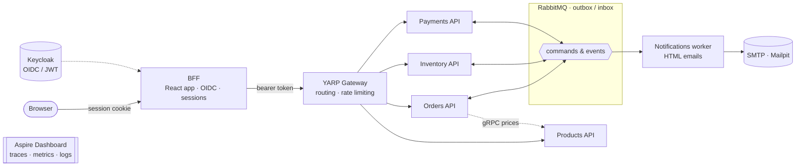
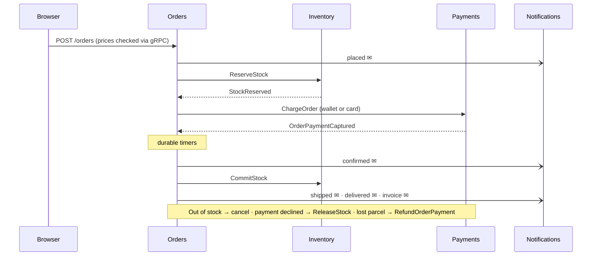

<div align="center">

# OrderFlow

**An event-driven order fulfillment platform built with .NET 10 microservices**

[](https://github.com/koksalenes/orderflow-microservices/actions/workflows/ci-cd.yml)
[](https://github.com/koksalenes?tab=packages&repo_name=orderflow-microservices)
[](https://dotnet.microsoft.com/)
[](https://learn.microsoft.com/dotnet/csharp/)
[](https://www.postgresql.org/)
[](https://www.rabbitmq.com/)
[](https://grpc.io/)
[](https://redis.io/)
[](https://www.keycloak.org/)
[](https://dotnet.github.io/yarp/)
[](https://opentelemetry.io/)
[](https://docs.docker.com/compose/)
[](https://react.dev/)
[](https://redux-toolkit.js.org/)
[](https://tanstack.com/)
[](https://tailwindcss.com/)
[](https://ui.shadcn.com/)

</div>

---

OrderFlow is a **case project** that models how an online order moves through a distributed system. A customer fills a cart and checks out with their **wallet balance** or a **card**; stock is reserved, the payment is captured, the order is confirmed, shipped, delivered, and invoiced, and the customer gets an email at every step. If a step fails, earlier steps are compensated automatically by a **saga**.

Each step is owned by an independent service with its own database. The services cooperate through **asynchronous messaging** (RabbitMQ, transactional outbox and inbox) for state changes and **gRPC** for the reads that must happen synchronously.

> **Status:** catalog with search and live stock, event-sourced wallet with card top-ups and snapshots, cart and checkout (wallet or card), the order saga with compensation, transactional emails with invoices, and CI/CD with multi-arch images on GHCR. Run it in one command, no build needed: [Quick start](#quick-start).

## Features

- **Storefront** (React): catalog with search and pagination, live stock badges, product pages with galleries, cart, checkout, *My orders* with a live saga timeline, wallet with an event stream view.
- **Wallet** (Payments): event sourcing with snapshots and projections; card top-ups settle asynchronously and are reversed by a saga when the (test) card network declines them.
- **Orders**: an orchestrated saga across Inventory and Payments — reserve stock → capture payment → confirm → ship → deliver → invoice — with durable timers and compensation (release stock, void authorization, refund).
- **Test scenarios built in**: out-of-stock cart, insufficient wallet balance, a card that is declined (`4000 0000 0000 0119`), and a lost parcel; each triggers a different compensation path.
- **Emails** (Notifications): HTML emails in English and Turkish for top-ups, reversals, and every order status, including an invoice with VAT; captured by Mailpit locally.
- **Security**: Keycloak sign-in through a BFF (no tokens in the browser), JWT validation in every service, CSRF header, rate limiting at the gateway.

## Architecture



The browser talks only to the **BFF** (Backend for Frontend): it serves the React storefront, signs users in with Keycloak, keeps all tokens on the server, and calls the APIs on the user's behalf. The browser holds nothing but an HttpOnly session cookie.

Every service runs as two containers: an **API** for HTTP traffic and a **Worker** for background processing (outbox publishing, message consumers, saga steps). Both share the same application and infrastructure code; only the host differs.

## Services

| Service | Responsibility | Highlights |
|---|---|---|
| **Products** | Catalog, prices, search | Dapper queries, seed data with real product photos, gRPC `ProductCatalog` for other services |
| **Inventory** | Stock levels and reservations | All-or-nothing reservations, optimistic concurrency (`xmin`), commit on shipping |
| **Orders** | Order lifecycle | **Saga orchestrator** with durable timers and compensation |
| **Payments** | Wallet, card payments, refunds | **Event-sourced** wallet with snapshots and projections; top-up settlement saga |
| **Notifications** | Email | Consumes order and wallet events; branded HTML emails (en/tr) with invoices |

Each service owns a separate PostgreSQL database. No service reads another service's data.

## Order saga



## Key patterns

| Pattern | Purpose |
|---|---|
| **Clean Architecture** | Domain, Application, Infrastructure, and host layers per service, with dependencies pointing inward |
| **CQRS** | EF Core for the write side, Dapper for reads; handlers injected directly, no mediator |
| **Transactional Outbox & Inbox** | Messages are stored in the same transaction as the state change and consumed idempotently |
| **Saga (orchestration)** | Orders drives the order flow and compensates failures; a second saga settles wallet top-ups |
| **Event Sourcing** | Payments stores every money movement as an event; snapshots keep loading fast; balances and history are projections |
| **Database per service** | Services evolve and scale independently |
| **Backend for Frontend** | Server-side OIDC session for the web app; tokens never reach the browser; CSRF header, back-channel logout, token refresh |
| **gRPC** | Synchronous service-to-service reads on a separate HTTP/2 port (Orders → Products prices) |
| **API Gateway** | YARP-based single entry point with routing, rate limiting, and health-aware load balancing |
| **Correlation id & distributed tracing** | The edge (BFF or gateway) creates an `X-Correlation-Id` that every service reuses and logs; OpenTelemetry traces span all hops |
| **RFC 9457 ProblemDetails** | Every error has the same shape with a stable error `code` |
| **Identity as code** | Keycloak realm, registration with captcha, email verification, and a branded login theme come up ready, with no admin-console setup |

## Tech stack

| Area | Technology |
|---|---|
| Runtime | .NET 10 (LTS), C# 14, Minimal APIs |
| Persistence | PostgreSQL 18, EF Core 10, Dapper |
| Messaging | RabbitMQ 4.1 (transactional outbox and inbox), gRPC |
| Email | MailKit, Mailpit |
| Caching | Redis 7.2 |
| Identity | Keycloak 26 (OIDC, JWT) with a custom login theme built with Keycloakify, React 19, Tailwind CSS 4, and shadcn/ui |
| Web app | React 19, TanStack Router, TanStack Query, Redux Toolkit, axios, Tailwind CSS 4, shadcn/ui |
| BFF | ASP.NET Core, OpenID Connect, Redis session store, YARP |
| Gateway | YARP 2.3 (ASP.NET Core reverse proxy) |
| Observability | Serilog, OpenTelemetry, Aspire Dashboard |
| Containers | Docker, chiseled .NET runtime images (non-root, no shell), multi-arch (amd64 + arm64) |
| CI/CD | GitHub Actions, GitHub Container Registry |
| Quality | Roslyn + SonarAnalyzer (warnings as errors), CSharpier, Husky.Net git hooks |

## Quick start

Run the whole platform from the published images, **no .NET SDK, Node, or build needed**. Requirements: Docker with Compose v2, `git`, `bash`, `openssl` (Windows: WSL or Git Bash).

```bash
git clone https://github.com/koksalenes/orderflow-microservices.git
cd orderflow-microservices
./scripts/start.sh            # latest images; ./scripts/start.sh v1.0.0 for a release
```

The script creates `.env` with random passwords and secrets, pulls the images from `ghcr.io/koksalenes/orderflow-microservices`, and waits until every container is healthy (first start: about a minute). Then open http://localhost:3000, create an account, and confirm it with the email in Mailpit.

| Endpoint | URL |
|---|---|
| **Web app (storefront)** | http://localhost:3000 |
| Mailpit (all emails) | http://localhost:8025 |
| Gateway (all APIs under `/api/v1/<resource>`) | http://localhost:8000 |
| Aspire Dashboard (traces, metrics, logs) | http://localhost:18888 |
| RabbitMQ management | http://localhost:15672 |
| Keycloak admin console | http://localhost:8080 |

Credentials for RabbitMQ and the Keycloak admin console are in `.env`. Stop with `docker compose --profile infra --profile apps down` (add `-v` to delete all data).

Try the failure paths at checkout: put more items in the cart than are in stock, pay with a wallet that is too low, use the card `4000 0000 0000 0119`, or tick *carrier loses the parcel*.

> This runs the production images on one machine. Before exposing it to the internet, add TLS, run Keycloak in production mode, and use real SMTP and payment providers.

## Development

**Requirements:** .NET SDK 10.0.401, Node 24, Docker with Compose v2, `make`.

```bash
make env    # creates .env from .env.example with generated secrets and passwords
make up     # builds the images from source and starts everything; waits until all containers are healthy
make ps     # lists containers and their health
```

### Everyday commands

| Command | What it does |
|---|---|
| `make start` | Run everything from the published images (no build); `make start TAG=v1.0.0` for a release |
| `make up` | Build images from source and start infrastructure, services, gateway, and the web app |
| `make web-dev` | Run the React app with hot reload on http://localhost:3000 (against a local BFF on :5111) |
| `make down` / `make stop` | Stop and remove the containers (data volumes are kept) |
| `make logs s=orders-api` | Follow the logs of one container |
| `make infra-up` | Start only the infrastructure, to run a service from the IDE |
| `make infra-reset` | Remove the containers **and all data volumes** |
| `make build` / `make test` | Build the solution / run the tests |
| `make` | List every target |

Run a single service from the IDE with `make infra-up` and its `http` launch profile (Products API on port 5101, then sequential ports per host). Set its connection string first:

```bash
dotnet user-secrets set "Database:ConnectionString" \
  "Host=localhost;Port=5432;Database=orders_db;Username=<user>;Password=<password>" \
  --project src/Services/Orders/OrderFlow.Orders.Api
```

## Repository layout

```
src/
├── Shared/                  Building blocks shared by every service (domain primitives, host defaults, web defaults)
├── Bff/                     Backend for Frontend (sign-in, sessions, API proxy)
├── Gateway/                 YARP API gateway
└── Services/
    └── <Service>/           Products · Inventory · Orders · Payments · Notifications
        ├── *.Contracts      Events, commands, and gRPC contracts the service exposes
        ├── *.Domain
        ├── *.Application
        ├── *.Infrastructure
        ├── *.Api
        └── *.Worker
web/app/                     React storefront served by the BFF
web/keycloak-theme/          Login, registration, password-reset pages and emails (Keycloakify + shadcn/ui)
deploy/                      Dockerfiles (multi-arch) and the Keycloak realm
scripts/                     start.sh (run published images), env.sh (generate .env), database initialization
.github/workflows/           CI/CD pipeline
```

## CI/CD

GitHub Actions (`.github/workflows/ci-cd.yml`):

| When | What |
|---|---|
| Every push and pull request | CSharpier format check, `dotnet build` with analyzers as errors, tests, React and Keycloak theme builds, compose validation, shellcheck |
| Push to `main` | All of the above, then 13 images pushed to `ghcr.io/koksalenes/orderflow-microservices/<image>` as `latest` and `sha-<commit>` for `linux/amd64` and `linux/arm64` |
| Tag `vX.Y.Z` | Images tagged `X.Y.Z` and `X.Y`, plus a GitHub Release with run instructions |

Images: `gateway`, `bff` (includes the React app), `keycloak` (includes the theme), and `<service>-api` / `<service>-worker` for products, inventory, orders, payments, and notifications. .NET cross-compiles for each architecture, so no emulation is needed.

Release a version:

```bash
git tag v1.0.0 && git push origin v1.0.0
```

## License

See [LICENSE.md](LICENSE.md).
