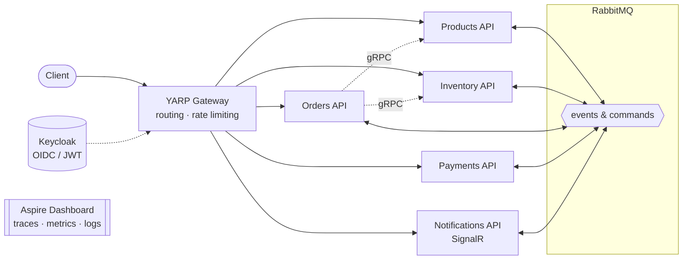
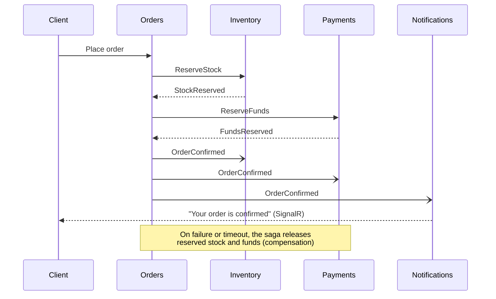

<div align="center">

# OrderFlow

**An event-driven order fulfillment platform built with .NET 10 microservices**

[](https://dotnet.microsoft.com/)
[](https://learn.microsoft.com/dotnet/csharp/)
[](https://www.postgresql.org/)
[](https://www.rabbitmq.com/)
[](https://redis.io/)
[](https://www.keycloak.org/)
[](https://dotnet.github.io/yarp/)
[](https://opentelemetry.io/)
[](https://docs.docker.com/compose/)

</div>

---

OrderFlow is a **case project** that models how an online order moves through a distributed system. A customer places an order; stock is reserved, the payment is taken from a wallet, and the customer is notified in real time. If any step fails, earlier steps are compensated automatically.

Each step is owned by an independent service with its own database. The services cooperate through **asynchronous messaging** for state changes and **gRPC** for the few reads that must happen synchronously.

> **Status:** the platform skeleton is in place: services, gateway, identity provider, messaging and storage infrastructure, observability, and containerization. Business features are implemented next, one service at a time.

## Architecture



Every service runs as two containers: an **API** for HTTP traffic and a **Worker** for background processing (outbox publishing, message consumers, saga steps). Both share the same application and infrastructure code; only the host differs.

## Services

| Service | Responsibility | Highlights |
|---|---|---|
| **Products** | Product catalog and prices | Read-heavy, cached in Redis; serves prices over gRPC |
| **Inventory** | Stock levels and reservations | Optimistic concurrency to prevent overselling |
| **Orders** | Order lifecycle | **Saga orchestrator** for the fulfillment flow, idempotent order placement |
| **Payments** | Wallet balance, fund reservations, refunds | **Event-sourced** ledger with snapshots and projections |
| **Notifications** | Email and live updates | Real-time push with **SignalR**; email via SMTP |

Each service owns a separate PostgreSQL database. No service reads another service's data.

## Order fulfillment flow



## Key patterns

| Pattern | Purpose |
|---|---|
| **Clean Architecture** | Domain, Application, Infrastructure, and host layers per service, with dependencies pointing inward |
| **CQRS** | EF Core for the write side, Dapper for reads; handlers injected directly, no mediator |
| **Transactional Outbox & Inbox** | Messages are stored in the same transaction as the state change and consumed idempotently |
| **Saga (orchestration + choreography)** | Orders coordinates the decision phase; the outcome event fans out to every service |
| **Event Sourcing** | Payments stores every money movement as an event; balances are projections |
| **Database per service** | Services evolve and scale independently |
| **API Gateway** | YARP-based single entry point with routing, rate limiting, and health-aware load balancing |
| **Distributed tracing** | One trace id from the gateway through every service, returned as `X-Request-Id` |
| **RFC 9457 ProblemDetails** | Every error has the same shape with a stable error `code` |

## Tech stack

| Area | Technology |
|---|---|
| Runtime | .NET 10 (LTS), C# 14, Minimal APIs |
| Persistence | PostgreSQL 18, EF Core 10, Dapper |
| Messaging | RabbitMQ 4.1 |
| Caching | Redis 7.2 |
| Identity | Keycloak 26 (OIDC, JWT) |
| Gateway | YARP 2.3 (ASP.NET Core reverse proxy) |
| Observability | Serilog, OpenTelemetry, Aspire Dashboard |
| Containers | Docker, chiseled .NET runtime images (non-root, no shell) |
| Quality | Roslyn + SonarAnalyzer (warnings as errors), CSharpier, Husky.Net git hooks |

## Getting started

**Requirements:** .NET SDK 10.0.401, Docker with Compose v2, `make`.

```bash
make env    # creates .env from .env.example — change the passwords before the first start
make up     # builds the service images and starts everything; waits until all containers are healthy
make ps     # lists containers and their health
```

| Endpoint | URL |
|---|---|
| Gateway (all APIs under `/api/v1/<resource>`) | http://localhost:8000 |
| Aspire Dashboard (traces, metrics, logs) | http://localhost:18888 |
| RabbitMQ management | http://localhost:15672 |
| Keycloak admin console | http://localhost:8080 |
| Mailpit (captured emails) | http://localhost:8025 |

### Everyday commands

| Command | What it does |
|---|---|
| `make up` | Build images and start infrastructure, services, and gateway |
| `make down` | Stop and remove the containers (data volumes are kept) |
| `make logs s=orders-api` | Follow the logs of one container |
| `make infra-up` | Start only the infrastructure, to run a service from the IDE |
| `make infra-reset` | Remove the containers **and all data volumes** |
| `make build` / `make test` | Build the solution / run the tests |
| `make` | List every target |

Run a single service from the IDE with `make infra-up` and its `http` launch profile (Products API on port 5101, then sequential ports per host). Set its connection string first:

```bash
dotnet user-secrets set "Database:ConnectionString" \
  "Host=localhost;Port=5432;Database=orders_db;Username=<user>;Password=<password>" \
  --project src/Services/Orders/OrderFlow.Orders.Api
```

## Repository layout

```
src/
├── Shared/                  Building blocks shared by every service (domain primitives, host defaults, web defaults)
├── Gateway/                 YARP API gateway
└── Services/
    └── <Service>/           Products · Inventory · Orders · Payments · Notifications
        ├── *.Contracts      Events, commands, and gRPC contracts the service exposes
        ├── *.Domain
        ├── *.Application
        ├── *.Infrastructure
        ├── *.Api
        └── *.Worker
deploy/                      Dockerfile and Keycloak configuration
scripts/                     Database initialization
```
